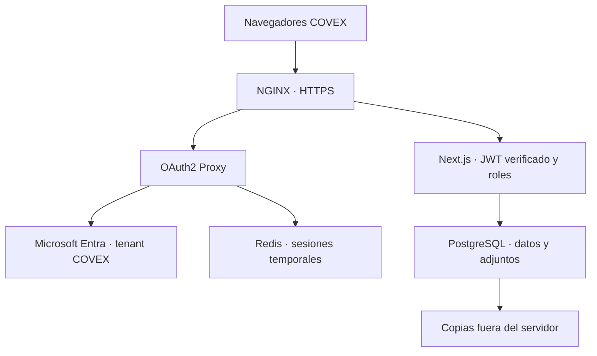

# COVEX Training Manager — Arquitectura para IT · H9A

La implantación acordada es una aplicación web en un ordenador/servidor privado de COVEX, con PostgreSQL y Microsoft Entra. Los usuarios acceden por navegador. Azure no es un requisito. SO, URL, red y certificados definitivos siguen pendientes de IT.

## Autenticación y autorización

El paquete privado usa `AUTH_MODE=entra-proxy`. OAuth2 Proxy realiza OIDC con un tenant único. NGINX consulta `/oauth2/auth` y reemplaza las cabeceras de identidad del cliente. Solo el token recibido del proxy autenticado llega a Next.js. El secreto aleatorio compartido vincula gateway y backend; Next.js verifica también la firma RS256 del JWT mediante las claves públicas de Entra, emisor, audiencia, expiración y claims `tid` y `oid`.

El identificador `oid` se busca en `UserProfile.entraObjectId`. El perfil debe existir y estar activo. Los roles `USER`, `RESPONSIBLE` y `ADMIN` siguen administrándose en la aplicación; no se deducen de email ni de cabeceras enviadas por el navegador. No hay contraseñas locales. `AUTH_MODE=app-service` se conserva exclusivamente para una infraestructura Azure Easy Auth que impida saltarse su autenticación; no se utilizará en el servidor privado.

## Componentes y almacenamiento

- Único puerto publicado: HTTPS del gateway. `BIND_ADDRESS=127.0.0.1` impide exponerlo antes de configurar la red aprobada.
- Next.js y OAuth2 Proxy no publican puertos en el host.
- PostgreSQL usa un volumen persistente y una red Docker interna, sin puerto publicado. La conexión sin TLS de este paquete está limitada a esa red en el mismo host; si IT externaliza PostgreSQL deberá configurar TLS, certificados y cadena de conexión para ese escenario.
- Los documentos de Formadores y las evidencias de Sesiones son binarios PostgreSQL. Deben incluirse en capacidad, copias y restauración. Los PDF de anexos se generan en memoria; sus metadatos se trazan en `GeneratedDocument`.
- Redis conserva sesiones de autenticación en memoria; su reinicio exige nuevo inicio de sesión y no afecta a los expedientes. No almacena documentos ni datos formativos.
- La aplicación y OAuth2 Proxy necesitan salida HTTPS a `login.microsoftonline.com`. Los navegadores necesitan acceso a Entra. Mantener reloj/NTP sincronizado.
- SharePoint, correo, firma electrónica e integración QMS se mantienen en el roadmap futuro.

## Responsabilidades

| Entrega H9A | Implantación IT / aceptación GC |
| --- | --- |
| Dockerfile y Compose productivo | SO y motor de contenedores aprobados |
| Adaptador Entra con validación JWT | Registro de aplicación, tenant y secreto |
| Migraciones y bootstrap del primer ADMIN | URL, DNS, certificado HTTPS y firewall |
| Scripts de instalación, actualización y backup | Retención, almacenamiento externo y permisos |
| Restauración de prueba aislada | Recuperación ante desastre y aceptación funcional |
| Pruebas automáticas técnicas | Login corporativo, perfiles y evidencia de aceptación |

Como punto de partida para dimensionar, evaluar 2 vCPU, 4–8 GB RAM y almacenamiento SSD para BD, documentos, imágenes y backups; son valores orientativos, no una capacidad certificada. IT fijará recursos a partir de usuarios concurrentes y crecimiento documental. El paquete usa contenedores Linux; en host Windows debe acordarse una VM Linux o una plataforma de contenedores Linux admitida por IT.

H9A prepara el paquete y su evidencia técnica. H9B realiza la instalación corporativa; H9C aborda migración/verificación de datos; H9D completa aceptación y puesta en servicio. El manual de usuario ya realizado no se vuelve a generar.
